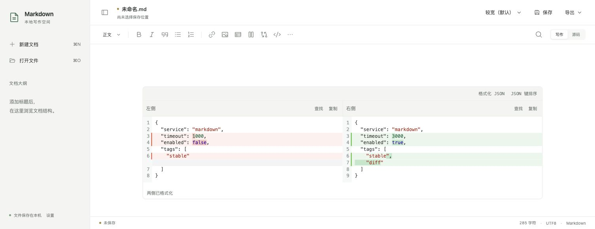
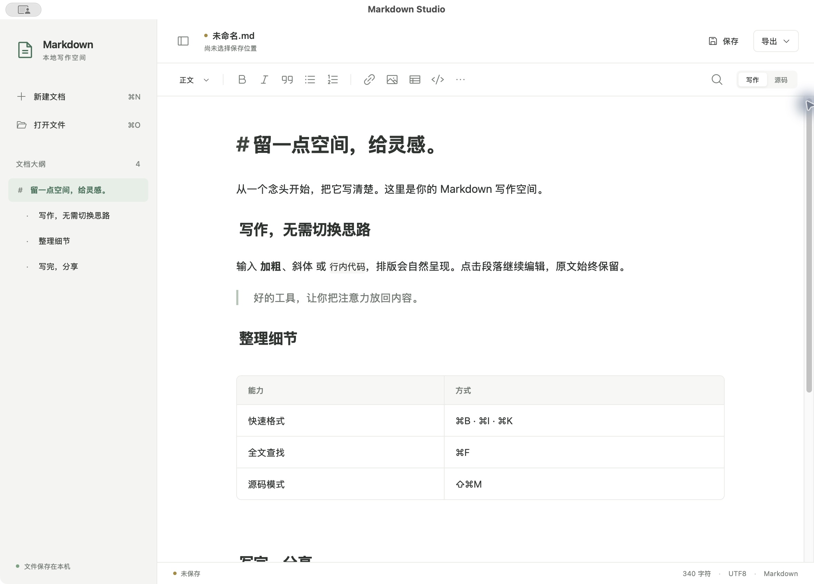
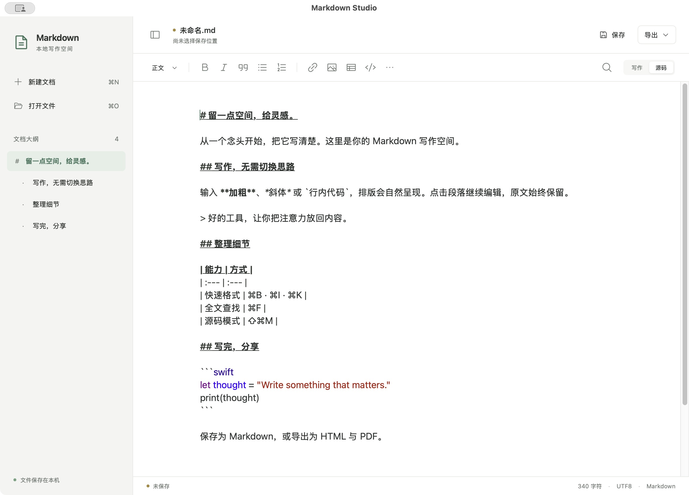
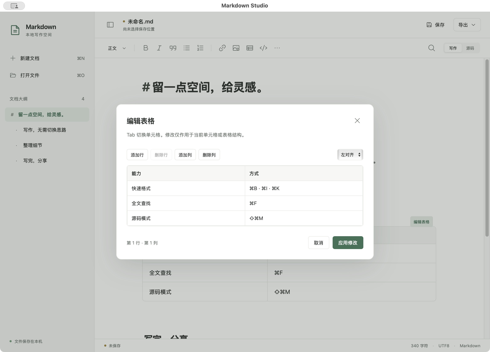

# Markdown Studio

面向 macOS 的本地 Markdown 编辑器，采用 Swift + AppKit / WKWebView 宿主与 React + CodeMirror 6 编辑界面。支持同区域编辑与预览、可视化表格、多分栏及 HTML / PDF 导出。当前构建和实现说明见 [DEVELOPMENT.md](DEVELOPMENT.md)；项目早期名称为 Typora Native。

## 与 Typora、CommonMark 的区别

Typora 是 Markdown 编辑器产品，CommonMark 是 Markdown 的语法与解析规范；本项目是可在本地构建、按需求修改的编辑器应用。因此，与 Typora 比较的是编辑体验和功能范围，与 CommonMark 比较的是语法兼容性。CommonMark 本身不规定窗口、快捷键、文件保存或表格编辑界面。参见 [Typora 官网](https://typora.io/) 与 [CommonMark 规范](https://spec.commonmark.org/)。

### 与 Typora：同区域写作，侧重表格与分栏交互

| 维度 | Markdown Studio（当前实现） | Typora |
| --- | --- | --- |
| 编辑方式 | CodeMirror 保存 Markdown 源文，通过装饰和组件实现实时排版，可切换源码模式 | 提供实时预览和源码模式，隐藏或按编辑状态展开 Markdown 标记 |
| 表格编辑 | 通过 Glide Data Grid 抽屉编辑：F2、区域复制粘贴、行列多选、增删与移动、排序；变更实时同步正文 | 提供可视化表格编辑、对齐，以及行列增删等操作 |
| 多分栏 | 支持栏内完整 Markdown 编辑、嵌套分栏和拖动分隔线调整相邻栏比例；使用本项目的 `div > section > md` 扩展语法 | 官方 Markdown 参考未定义本项目的分栏语法，不能假设会还原相同布局与编辑交互 |
| 内容保存 | 使用局部文本补丁，保留未修改区域的原始格式、文件编码和换行；结构操作限定在相应表格或分栏范围内 | 同样以 Markdown 文件为载体；此处不对其内部存储、序列化或字节保持策略作推断 |
| 功能范围 | 当前重点是本地写作、表格、图片和分栏，支持 HTML / PDF 导出；公式、Mermaid 尚未实现 | 官方列有数学公式、图表、主题及更多导入导出能力 |
| 运行范围 | 当前交付 macOS 应用，使用 WKWebView；浏览器模式用于开发预览 | 提供 macOS、Windows 和 Linux 版本 |

Typora 也具备可视化表格和实时预览，本项目的区别主要在具体交互与可定制实现，不代表这些能力是本项目独有，也不代表已经覆盖 Typora 的全部功能。对比依据：[Typora Markdown 参考](https://support.typora.io/Markdown-Reference/)及[官网功能介绍](https://typora.io/)（核对日期：2026-10-12）。

### 与 CommonMark：基础 Markdown、扩展语法和应用行为分开看

| 内容 | 本项目的处理方式 | 与 CommonMark 的关系 |
| --- | --- | --- |
| 标题、段落、强调、引用、列表、链接、图片、代码块 | 基于 CodeMirror Markdown 解析进行编辑；组件展示及导出使用 marked，并通过 DOMPurify 清理 HTML | 属于基础 Markdown 范围，但本项目尚未完成完整 CommonMark 一致性测试，不承诺所有边界情况完全一致 |
| 管道表格、删除线等 | 支持相应编辑或展示能力，HTML 渲染启用 marked 的 GFM 模式 | 属于 GFM 等扩展，不属于 CommonMark 核心；启用 GFM 也不等于整个编辑器已通过 GFM 一致性验证 |
| 多分栏 | 识别 `div.columns > section > md` 结构，渲染其内部 Markdown，按 `data-ratios` 排列栏宽 | 本项目自定义扩展；CommonMark 不定义 `<md>` 的递归 Markdown 渲染或分栏行为 |
| 图片对齐与尺寸 | 使用 HTML `img` 属性保存，提供悬浮对齐工具和等比例缩放 | HTML 可以作为文档内容，但具体布局与可视化调整不由 CommonMark 规定，外部渲染器也可能过滤属性 |
| 页面宽度、表格列宽与文件操作 | 页面宽度按本机文档记忆，网格列宽用于编辑；拖入文档通过窗口打开 | 属于应用行为，不是 Markdown 语法，不会因复制 Markdown 文件而自动获得相同配置 |

CommonMark 定义了原始 HTML 的解析规则，但不能据此认为 HTML 标签内部的文本一定会再次作为 Markdown 解析。本项目会先识别分栏结构，再分别解析各栏内容。例如：

```html
<div class="columns" data-ratios="2,1" style="display:grid;grid-template-columns:minmax(0,2fr) minmax(0,1fr);gap:24px;align-items:start">
<section style="min-width:0;overflow-wrap:anywhere;white-space:pre-wrap">
<md>
## 左栏

这里可以写 **Markdown**。
</md>
</section>
<section style="min-width:0;overflow-wrap:anywhere;white-space:pre-wrap">
<md>
## 右栏

- 支持列表
- 支持独立编辑
</md>
</section>
</div>
```

这段内容在本项目中显示为 2:1 的两栏。外层 section 和内联 CSS Grid 让保留 HTML / style 的其他渲染器也能显示分栏；如果不支持 md 扩展，栏内可能仍显示 Markdown 源文。过滤 HTML 或内联样式的平台（例如 GitHub）不保证保留分栏效果。向外分享时，优先使用双方支持的 Markdown 语法；需要保留分栏展示时，可以导出 HTML / PDF。HTML 导出会将分栏转换为 CSS Grid，但不会附带本应用的编辑交互。

规范参考：[CommonMark](https://spec.commonmark.org/)、[GitHub Flavored Markdown](https://github.github.com/gfm/)。

## 双栏代码 Diff

工具栏点击「插入代码对比」即可插入。选中的文本会填入左侧，两侧都可编辑或粘贴代码，修改实时写回 Markdown；支持放在分栏内。

- 基于 CodeMirror MergeView，参考 IDEA 的双栏交互：对齐对应行，标出新增、删除，并高亮行内变化；并非复用 IDEA 的内部算法。
- 两侧支持独立查找：焦点位于对应代码侧时按 ⌘F / Ctrl+F，或点击该侧「查找」；支持上一个 / 下一个、大小写、正则和替换，Esc 关闭。
- 组件右上角的「格式化 JSON」「JSON 键排序」一次处理左右两侧，整体一步撤销；查找与复制仍分别作用于所在侧。排序递归处理对象键，保留数组顺序及长整数原始精度；任一侧 JSON 无效时提示对应侧，两侧均保留原文。
- 与正文共用撤销 / 重做历史，格式化和排序可单独撤销。长代码不自动折行，支持滚动。
- 内容保存为 `md-diff` 专用代码围栏，内部 JSON 保存 `left` / `right` 字符串。普通 Markdown 渲染器会将其作为代码块显示；本应用导出 HTML / PDF 时保留双栏和差异高亮。



## 典型截图

以下为当前 **Markdown Studio 前端重写版**的 macOS 应用实拍，采用 React + CodeMirror 6 + Radix，运行在原生 WKWebView 宿主中。当前构建与启动方法见 [DEVELOPMENT.md](DEVELOPMENT.md)，验收记录见 [VALIDATION.md](VALIDATION.md)；下方原有章节保留的是早期纯 AppKit 版本说明。

支持将 `.md`、`.markdown`、`.txt` 文件拖到应用界面，在独立窗口打开（多文件逐个打开，已打开文件激活已有窗口）；当前文档及未保存修改保持不变。拖入图片仍用于插图。

双击编辑区空白处可插入空行并放置光标；双击文字仍为选词。双击文末下方空白会按距离补足换行，双击行尾空白则在该行之后插入一行。

大纲侧栏支持拖动右边缘调整宽度，并自动记住设置；双击边缘恢复默认宽度，聚焦分隔线后可用左右方向键微调。

### 写作与文档大纲

在同一区域输入和预览 Markdown，左侧大纲用于定位标题，顶部提供格式操作、保存和导出。



### Markdown 源码模式

随时切换到源码模式，查看并直接编辑标题、行内格式、表格与围栏代码的原始语法。



### 可视化表格编辑

通过网格修改单元格，增删行列和设置对齐；支持 Tab / Shift-Tab 连续编辑。



## 运行（早期纯 AppKit 版本）

> 从本节到“实现边界”保留早期实现记录，不适用于当前前端重写版。当前运行方式、编辑模型和验证命令以 [DEVELOPMENT.md](DEVELOPMENT.md) 为准。

环境：macOS 13+、Swift 6 / Xcode 16+。本次已在 macOS 15.6.1、Apple Silicon、Xcode 26.3 上构建验证。

```bash
cd /Users/bytedance/code/typora-spec
./scripts/build-app.sh
open 'dist/Typora Native.app'
```

打开示例：

```bash
open -a "$PWD/dist/Typora Native.app" "$PWD/Resources/Welcome.md"
```

也可通过 `swift run TyporaNative /absolute/path/document.md` 启动。生成的 `.app` 使用本地 ad-hoc 签名；当前构建对应本机 arm64 架构。

## P0 能力

- 新建、打开、保存、另存为，多窗口及关闭前的未保存提示。
- 同区域实时预览、源码切换，原生撤销重做、剪贴板及查找替换。
- 标题、加粗、斜体、删除线、引用、列表、行内代码和链接。
- 围栏代码块、语言选择、常见语言的轻量语法高亮；未知语言按纯文本显示。
- 表格原生网格预览、单元格编辑、增删行列、对齐、Tab 导航。
- 拖入/粘贴图片并复制到文档旁的 `assets/`；相对路径、替代文本和链接编辑。
- 按原始文本位置定位的大纲，重复标题也能分别跳转。
- HTML / 分页 PDF 导出；HTML 内嵌本地图片，缺失本地图片会提示修复。
- 本地恢复草稿、外部文件变化提示、保存前冲突检查及原子写入。

## 原文保持规则

1. `NSTextStorage.string` 保存 Markdown 原文。预览只改变属性或布局层绘制，不通过 AST 重建文档。
2. 格式操作使用 UTF-16 范围替换，进入原生撤销栈；未选中内容不做格式整理。
3. 普通表格单元格编辑只替换单元格内容；列对齐只修改该列分隔符。增删行列的改动限定在当前表格范围内。
4. 保存保留 UTF-8、UTF-8 BOM、带 BOM 的 UTF-16 LE/BE，以及已有的混合换行、空格和末尾换行状态。新插入的换行跟随文档检测到的首个换行风格。其他编码拒绝无损要求无法保证的写入。
5. 文件通过原子替换写入，比较的是打开/上次保存时的完整字节基线。目标是让 Git diff 只包含实际编辑，不是原地改写磁盘上的几个字节。
6. 实时预览在活动段落显示语法；非活动图片和表格通过原生布局绘制。超过 10 万 UTF-16 单元的文档限制在可见段落及选区更新显示。

## 常用操作

| 操作 | 快捷键 / 入口 |
|---|---|
| 保存 / 另存为 | ⌘S / ⇧⌘S |
| 源码 / 预览 | ⇧⌘M |
| 加粗 / 斜体 | ⌘B / ⌘I |
| 标题 1–6 | ⌘1–⌘6 |
| 链接 / 图片引用 | ⌘K，光标位于引用中时编辑已有引用 |
| 表格 | ⌥⌘T；光标在表格内时打开编辑窗口 |
| 代码块 / 语言 | ⌥⌘C；光标在代码块内时只修改语言标识 |
| 查找 / 替换 | ⌘F / ⌥⌘F |
| 上移 / 下移行 | ⌥↑ / ⌥↓（Alt+↑ / Alt+↓）；选中多行时整体移动，支持撤销 |
| PDF 导出 | ⇧⌘E |

未命名文档插入图片时先选择文档保存位置。跨目录另存为时，可选择复制相对路径图片或仅保存文档；图片复制不会覆盖内容不同的现有文件。撤销正文中的图片引用不会删除已复制的资产。

恢复草稿位置：`~/Library/Application Support/TyporaNative/Recovery/`。编辑停止约 400 ms 后写入，切出应用时也会刷新；异常退出后启动应用会恢复已经落盘的草稿。恢复草稿不代表原文件已经保存。

## 验证

```bash
swift test
swift run -c release TyporaNative --smoke-test .build/native-smoke
./scripts/build-app.sh
```

- `swift test`：编码与字节保持、范围编辑、Unicode、表格、冲突保护、恢复记录、导出等回归。
- 原生集成验证：真实 NSTextView 格式化、撤销重做、IME 组合输入、预览模式、图片、表格显示、精确保存及 PDF 分页。
- 测试输出仅写入 `.build/`，构建结果写入 `dist/`，均不纳入 Git。

验收证据与范围见 [VALIDATION.md](VALIDATION.md)，产品功能规格见 [SPEC.md](SPEC.md)。

## 实现边界

- 支持本项目 P0 所列 Markdown 子集，并非完整 CommonMark/GFM 一致性实现；未知语法保留原文，原始 HTML 在导出时转义显示。
- 表格修改通过原生编辑窗口完成；进入表格所在段落编辑时会展开原文。单独占一行的图片支持直接预览。
- 网络图片需要联网；HTML 保留远程图片 URL，本地图片内嵌。远程图片获取失败时保留可修改的原始引用。
- PDF 使用系统富文本导入与打印排版，样式不保证与 HTML 像素一致。PDFKit 可能将部分汉字提取为兼容字符，测试使用 Unicode 兼容归一化比较。
- 文件树/跨文档搜索、公式、Mermaid、主题定制、Pandoc 属于 P1/P2。
- 当前为本地构建，尚未进行开发者证书签名、公证或 Intel 实机验证。

## TODO

- [ ] 支持 Mermaid 绘图：将 `mermaid` 围栏代码块渲染为图表（暂不实现）。
